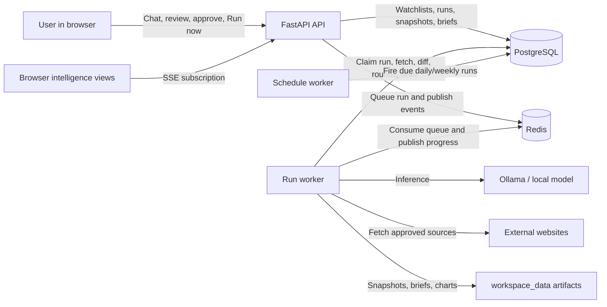

# AgentFlow

**A local-first competitive intelligence platform: watch approved competitor sources, detect what changed, and produce evidence-linked briefs.**

AgentFlow helps founders, product managers, and small product teams answer one question on repeat: *what changed in these competing products, what supports it, and why does it matter to us?* You define a watchlist (your own product, competitors, and the exact public pages you allow), approve a revision, and run it manually or on a schedule. The platform fetches the sources, captures and diffs snapshots deterministically, investigates meaningful changes with bounded multi-agent rounds, and renders a typed brief you can download as Markdown. Inference runs locally through Ollama.

> **Project status:** active personal-project prototype on `dev`. The competitive-intelligence vertical slice works end to end — watchlist → approve revision → scheduled/manual run → researcher fetch → snapshot capture/normalize → deterministic diff → coordinator rounds → baseline promotion → typed brief + Markdown download. Merged on dev: PRs #43–#56 and #65–#69; migrations 0001–0011; unit suite 411 tests passing (4 documented skips).
>
> Release acceptance is still a **manual, human-gated** step: live-source/model quality, human review time, backup/restore drill, and measured quality/latency thresholds are not signed off. A two-run live trial (Oct 2026, `qwen3:4b`) completed in ~20–30 s/run — `baseline_created` then `no_change`, 0 false removals — with partial task coverage; provider token usage is unavailable from local Ollama, so token numbers are estimates. AgentFlow is not a production-ready hosted service.

## Contents

- [What works today](#what-works-today)
- [Architecture at a glance](#architecture-at-a-glance)
- [Agent roles](#agent-roles)
- [Technology](#technology)
- [Run with Docker Compose](#run-with-docker-compose)
- [Run locally for development](#run-locally-for-development)
- [Testing](#testing)
- [Evaluation](#evaluation)
- [Repository layout](#repository-layout)
- [Documentation](#documentation)
- [Current scope and limitations](#current-scope-and-limitations)
- [Contributing](#contributing)
- [Security](#security)

## What works today

The competitive-intelligence vertical slice, end to end:

1. **Set up a watchlist.** In the Chat (Assistant) tab, describe your products and sources and accept a setup proposal — candidate products and sources carry explicit provenance labels (`model_knowledge` / `user_supplied`) and are never silently approved — or use the manual watchlist form. A watchlist holds your own product, competitor products, comparison criteria, and the exact approved public URLs.
2. **Approve a revision.** Any edit creates a new unapproved revision. Approving pins goals, product profile versions, criteria, source scope, and budgets, and attaches the immutable collection workflow. Chat text can never approve a run; one active run per watchlist with owner-scoped idempotency.
3. **Run manually or on a schedule.** *Run now* starts a run against the current approved revision; daily/weekly schedules are fired by a server-side scheduler (no browser required) and outcomes land in the in-app notification center.
4. **Collect and compare.** The source researcher fetches approved URLs with a static-first crawler — same-site redirect tolerance, listing vs. article classification, login-wall detection — with browser fallback behind `AGENTFLOW_CRAWLER_BROWSER_ENABLED`. Snapshots are captured and normalized, then a deterministic section-aware diff against pinned baselines produces change candidates. A failed fetch is never a removal.
5. **Investigate.** A code-owned coordinator plans bounded rounds of researcher / verifier / analyst / report tasks within the approved scope and budget. Rounds are validated and persisted by code before execution and append to the live plan without mutating the approved workflow.
6. **Conclude.** A completed run promotes eligible baselines via compare-and-swap and builds a typed brief — per-source coverage, findings with before/after evidence, conflicts, limitations, advisory actions — rendered deterministically to downloadable Markdown. Outcomes are explicit and independent of run lifecycle status: `baseline_created`, `no_change`, `changes_detected`, `partial`, `rebaseline_required`, or `unavailable` (a failed run shows as `failed` with scope and baselines unchanged).

In the app:

| Surface | Contents |
| --- | --- |
| Chat / Assistant | Setup proposals, research/workflow conversation, plan review and approval, run progress nodes |
| Watchlists (Intelligence) | Watchlist list and detail with Overview / Changes / Briefs / Settings; change feed and detail; brief view + Markdown download; *Run now*, approve, cancel |
| Watchlist Settings | Schedules (daily/weekly), timeline, structured history Q&A |
| Briefs & History | Cross-watchlist brief list and run history |
| Header | In-app notification center for run outcomes |
| Advanced surfaces | Workflow editor, agent/tool catalogs, execution tracker, technical logs |

Timeline and Q&A are structured-first (no vector search): temporal questions answer from the timeline, factual questions from latest baseline spans, summaries from brief aggregation, with keyword fallback over briefs/findings. Every factual claim cites a resolvable snapshot span; unknown answers return "not observed" and are never invented.

## Architecture at a glance

- **Modular monolith:** one FastAPI application with separate API, run-worker, and scheduler processes; React frontend in front.
- **Data:** PostgreSQL is the source of truth (identity, conversations, watchlists/revisions, runs/tasks, snapshots, rounds, briefs, notifications); Redis coordinates the queue and realtime fan-out; large immutable files (snapshots, briefs, charts) live under `workspace_data/`.
- **Build phase:** chat or form proposes a `WatchlistRevision`; the user approves it; run admission freezes the approved configuration and budgets.
- **Run phase:** a background worker claims the queued run; a code-based dispatcher executes ready DAG tasks (currently one at a time); role agents call only whitelisted tools inside a ReAct loop with `<tool_output>` wrapping; coordinator rounds are code-owned, never raw model output executed directly.
- **Inference and guardrails:** local Ollama with server-side model routing (chat/planner/worker profiles, no model picker in the UI); the backend owns diffs, arithmetic, ownership, budgets (`MAX_RUN_*`), scheduling, and permissions.



| Component | Responsibility |
| --- | --- |
| React frontend | Chat/Assistant, intelligence workspace, run progress, results and downloads |
| FastAPI modular monolith | Authentication, conversations, watchlists, runs, catalog, CI read APIs, contracts |
| Background run worker | Claim queued runs and execute task agents outside the HTTP request |
| Schedule worker | Fire due daily/weekly schedules exactly once (separate process) |
| Code-owned CI pipeline | Snapshot capture/normalize, deterministic diff, baseline CAS promotion, coordinator rounds, brief assembly |
| PostgreSQL | Users, conversations, workflows, runs, CI metadata, evidence, artifact metadata |
| Redis | Run queue and realtime event distribution |
| Local artifact storage | Snapshots, reports, charts, briefs under `workspace_data/` |
| Ollama | Local LLM inference; model files are managed separately by Ollama |

MongoDB and Mongo Express also start with the Compose stack for development experiments. Application-level MongoDB persistence is disabled (`ENABLE_MONGODB=false`), and the current run-persistence path does not require MongoDB.

## Agent roles

Nine roles are seeded into the agent catalog; the coordinator that plans investigation rounds is code-owned and never calls a model. Not every run invokes every role — a no-change run may need no analytical LLM call.

| Role | Responsibility |
| --- | --- |
| Supervisor | Build-phase conversation, intent analysis, plan proposal |
| Worker | Generic task execution with the task's authorized tools |
| Source Researcher | Fetch and collect approved public evidence; report coverage gaps |
| Product Analyst | Extract product facts from snapshots and candidates |
| Evidence Verifier | Check support, contradictions, dates, and conditions (quotation-level) |
| Competitive Analyst | Assess relevance against the own-product profile and criteria |
| Synthesis Agent | Cross-source reconciliation for synthesis tasks |
| Report Agent | Present validated analysis; deterministic Markdown/tables |
| Chart Agent | Conditional charts for genuinely comparable structured data |

The backend owns permissions, storage, diffs, arithmetic, validation, budgets, and task scheduling. Agents cannot grant themselves tool access; each role has an explicit tool whitelist.

## Technology

- **Backend:** Python 3.11, FastAPI, SQLAlchemy, Pydantic, Alembic (migrations 0001–0011)
- **Agent runtime:** LangChain, LangGraph, Ollama
- **Frontend:** React 18, Vite
- **Persistence and coordination:** PostgreSQL, Redis; local filesystem for artifacts
- **Crawler:** static-first fetching with optional Playwright/Chromium fallback
- **Development and CI:** Docker Compose, GitHub Actions (unit + CI replay + integration + frontend), `unittest`, ESLint, Vitest

## Run with Docker Compose

The Compose stack includes the frontend, API, run worker, database initialization, PostgreSQL, Redis, and MongoDB/Mongo Express development services:

```powershell
Copy-Item .env.example .env
# Set a unique AUTH_SIGNING_SECRET in .env before starting.
docker compose up --build
```

The `db-init` service applies Alembic migrations and seeds the agent/tool catalog before the API and worker start.

| Surface | URL |
| --- | --- |
| Frontend | <http://localhost:5173> |
| API / OpenAPI docs | <http://localhost:8000/docs> |
| Mongo Express (dev) | <http://localhost:8081> |

**Ollama is not included in the Compose stack.** For model-backed execution, the API and worker containers must reach your Ollama host: set `OLLAMA_BASE_URL` in `.env` to a host-reachable Ollama address and make sure Ollama accepts connections from Docker; Compose forwards that URL and the three model-profile settings to both services.

Notes:

- The API container runs with `AGENTFLOW_CRAWLER_BROWSER_ENABLED=false`; the worker container installs Chromium and runs with browser fallback enabled.
- The CI schedule worker (`app.workers.schedule_worker`) is **not** a Compose service. If you use schedules, run it as an additional process (see below) against the same database.

## Run locally for development

The recommended development setup runs PostgreSQL and Redis in Docker, with Ollama, the API, worker, and frontend as local processes. This lets the backend reach Ollama at `localhost:11434` without container networking.

### Prerequisites

- Windows, macOS, or Linux
- Python 3.11
- Node.js and npm (Node.js 20+ recommended)
- Docker Desktop or Docker Engine with Compose v2
- [Ollama](https://ollama.com/download) with at least one supported chat model

### 1. Get the code and prepare configuration

From PowerShell:

```powershell
git clone https://github.com/TrungHocCode/agentflow.git
cd agentflow
Copy-Item .env.example .env
```

Edit `.env` and replace `AUTH_SIGNING_SECRET` with a unique random value before starting the application. Keep `.env` private; do not commit it (it is git-ignored).

Create and activate the Python environment, then install the backend dependencies:

```powershell
py -3.11 -m venv .venv
.\.venv\Scripts\Activate.ps1
python -m pip install --upgrade pip
python -m pip install -r requirements.txt
```

If PowerShell blocks environment activation, use the Python executable directly at `.venv\Scripts\python.exe`.

### 2. Start PostgreSQL and Redis

The sample configuration expects PostgreSQL on port `5433` and Redis on `6379`:

```powershell
docker compose up -d postgres redis
```

Apply database migrations (Alembic 0001 → 0011) and seed the default agent/tool catalog:

```powershell
python backend/app/db/init_db.py
```

### 3. Start Ollama and choose models

Start the Ollama application or run `ollama serve` in another terminal, then pull the models named in your configuration:

```powershell
ollama pull qwen3:0.6b
ollama pull qwen3:8b
ollama list
```

Model routing is server-side and configured with environment variables — there is no model picker in the UI:

| Variable | Repository default | Purpose |
| --- | --- | --- |
| `LLM_BASE_URL` | `http://localhost:11434` | Ollama endpoint |
| `OLLAMA_BASE_URL` | (empty) | Optional override when API/worker run in Docker |
| `LLM_CHAT_MODEL` | `qwen3:0.6b` | Short chat/small-talk profile |
| `LLM_PLANNER_MODEL` | `qwen3:8b` | Planning/workflow requests |
| `LLM_WORKER_MODEL` | `qwen3:8b` | Tool-using task execution |

Two files can set these values — pydantic-settings reads only the `.env` in the process's working directory, so pick one place for your overrides:

- **Root `.env`** (from `.env.example`): the main configuration; the commands below start processes from the repository root, and Docker Compose always uses it.
- **`backend/.env`** (optional, git-ignored): local overrides auto-loaded when a process starts with `backend/` as its working directory — for example, the October 2026 live trial pinned `LLM_PLANNER_MODEL`/`LLM_WORKER_MODEL` to `qwen3:4b-instruct-2507-q4_K_M` there.

Plain environment variables set in the shell take precedence over both files.

### 4. Start the API

From the repository root, in a new PowerShell terminal with the virtual environment activated:

```powershell
$env:PYTHONPATH = (Join-Path (Get-Location) "backend")
python -m uvicorn app.main:app --reload --host 127.0.0.1 --port 8001
```

The API listens on **8001** because the Vite dev server proxies `/api` to `http://localhost:8001` (`frontend/vite.config.js`). If you change the port, update that proxy target. The interactive API documentation is available at <http://localhost:8001/docs>. The Compose stack exposes the API on port 8000 instead.

### 5. Start the background worker

Run the worker in a separate terminal. Keep it running while testing runs; the API queues long-running work but does not execute it inside the request handler.

```powershell
$env:PYTHONPATH = (Join-Path (Get-Location) "backend")
python -m app.workers.run_worker
```

You should see a log indicating that the AgentFlow execution worker started.

### 6. (Optional) Start the schedule worker

Scheduled daily/weekly watchlist runs are fired by a dedicated process that ticks once per minute and is independent of the browser and SSE:

```powershell
$env:PYTHONPATH = (Join-Path (Get-Location) "backend")
python -m app.workers.schedule_worker
```

Without this process, manual runs still work; schedules simply do not fire.

### 7. Start the frontend

In another terminal:

```powershell
cd frontend
npm ci
npm run dev
```

Open <http://localhost:5173>, register or sign in, create a watchlist (chat proposal or manual form), approve it, start a run, and follow progress in the intelligence workspace. Vite proxies `/api` requests to the backend on port 8001.

### Artifacts, crawler, and budgets

Reports, snapshots, evidence, and downloads use `ARTIFACT_ROOT` (default: `workspace_data`, resolved against the repository root so API and worker agree). Producers use unique staging paths; after owned artifact metadata is saved, downloads use the durable copy.

The crawler tries static HTTP fetching first and uses Chromium only when content extraction is poor or the page needs client-side rendering. For local browser fallback, install Chromium once:

```powershell
python -m playwright install chromium
```

Static fetching works without browser fallback. Browser rendering is bounded and does not bypass authentication, CAPTCHAs, or anti-bot protections. These settings are read by the worker process:

| Environment variable | Default | Purpose |
| --- | ---: | --- |
| `AGENTFLOW_CRAWLER_BROWSER_ENABLED` | `true` | Enable or disable browser fallback |
| `AGENTFLOW_CRAWLER_BROWSER_TIMEOUT_MS` | `18000` | Maximum page-navigation time |
| `AGENTFLOW_CRAWLER_BROWSER_SETTLE_MS` | `600` | Brief wait for client-rendered content |
| `AGENTFLOW_CRAWLER_BROWSER_MAX_CONCURRENCY` | `1` | Maximum simultaneous browser pages per worker |
| `AGENTFLOW_CRAWLER_BROWSER_SLOT_TIMEOUT_SECONDS` | `2` | Maximum wait for an available browser slot |

Run-wide guardrails share `MAX_RUN_LLM_CALLS` (64), `MAX_RUN_ESTIMATED_TOKENS` (262144), and `MAX_RUN_DURATION` (3600 s) across ReAct, map/reduce, and coordinator calls. Token admission uses a conservative estimate plus reserved output — not exact Ollama usage — and exhaustion is explicit and never auto-retried. Cancellation is cooperative.

## Testing

| Command | What it does |
| --- | --- |
| `python scripts/run_tests.py unit` | Isolated unit suite (temporary workspace, mocked HTTP/DNS, no live model). Currently **411 tests, 4 documented skips**. |
| `python scripts/run_tests.py integration` | Real PostgreSQL/Redis suite against disposable services only; see [integration test setup](integration_tests/README.md). Never point it at development data. |
| `python scripts/run_ci_evaluation.py` | Deterministic CI scenario replay (10 fixed scenarios, no network/model); non-zero exit on any mismatch. Gated in CI. |
| `cd frontend; npm run lint; npm test -- --run; npm run build` | Frontend lint, Vitest component tests, production build. |

`python -m unittest discover tests/` still works as legacy discovery, but it does not install the suite-level network guard — prefer `scripts/run_tests.py unit`.

GitHub Actions runs the isolated unit suite, the CI scenario replay, and compile checks; a separate job runs the real PostgreSQL/Redis integration suite; a third runs frontend lint/test/build — all on pull requests to `dev` and `main`.

## Evaluation

The versioned [evaluation harness](evaluation/README.md) records one structured JSON file per run under git-ignored `workspace_data/evaluations/` and summarizes latency, throughput, coverage, and outcomes. Metric definitions and timing boundaries are in [evaluation/metrics.md](evaluation/metrics.md); research-quality metrics such as citation coverage are **manual** per-run observations, not automated scores.

```powershell
# Record and finish an evaluation run
python scripts/evaluation_runs.py new --case-id llm-benchmark-comparison --model qwen3:8b --quantization Q4_K_M --mode live
python scripts/evaluation_runs.py finish <record.json> --execution-status completed --verdict needs_review --agentflow-run-id <run-id>
python scripts/evaluation_runs.py validate <record.json>
python scripts/evaluation_runs.py summary

# Isolated Ollama latency/throughput benchmark (no prompt or completion content is stored)
python scripts/benchmark_ollama.py --model qwen3:8b --requests 8 --concurrency 1 --output workspace_data/evaluations/ollama-qwen3.json

# Summarize API latency/RPS from a redirected uvicorn stderr log
python scripts/summarize_http_metrics.py workspace_data/api-http.jsonl --window-seconds 60
```

Per-call/per-task application metrics (LLM TTFT/ITL/tokens where the provider reports them, tool timings, budget consumption, critical path) are opt-in: set `ENABLE_EXECUTION_BENCHMARK_METRICS=true` in `backend/.env` and restart the API and worker. Keep it off for normal runs. The deterministic CI scenario replay (`scripts/run_ci_evaluation.py`) is separate from live evaluation — replay proves fixture behavior, not live model quality.

## Repository layout

```text
agentflow/
├── backend/
│   ├── alembic/            # Migrations 0001–0011
│   └── app/
│       ├── api/            # FastAPI routers (~80 routes): auth, conversations, workflows,
│       │                   # runs, watchlists, CI reads, catalog, health
│       ├── modules/        # Business logic: identity, conversations, workflows, runs,
│       │                   # competitive_intelligence (snapshots, rounds, briefs,
│       │                   # schedules, timeline, Q&A, notifications), results
│       ├── execution/      # LangGraph graph, 9 agent roles, tools (crawler, HTTP, search),
│       │                   # research map/reduce, run budgets, benchmark metrics
│       ├── infrastructure/ # PostgreSQL/Redis/artifact adapters, container wiring
│       ├── workers/        # run_worker (queue) and schedule_worker (daily/weekly)
│       └── db/             # init_db: Alembic upgrade + agent/tool catalog seed
├── frontend/               # React + Vite: Chat/Assistant + Intelligence workspace
├── evaluation/             # Evaluation contract, metrics definitions, CI scenario fixtures
├── scripts/                # run_tests, run_ci_evaluation, evaluation_runs,
│                           # benchmark_ollama, summarize_http_metrics
├── tests/                  # Unit suite (isolated, mocked dependencies)
├── integration_tests/      # Real PostgreSQL/Redis suite (disposable services)
├── docs/                   # Private product/architecture docs (git-ignored)
├── workspace_data/         # Generated artifacts, snapshots, evaluations (git-ignored)
├── docker-compose.yml
└── requirements.txt
```

## Documentation

- **[docs/README.md](docs/README.md)** — index for the private product/architecture documentation: [PROJECT_CORE](docs/PROJECT_CORE.md) (product promise), [IMPLEMENTATION_ROADMAP](docs/IMPLEMENTATION_ROADMAP.md) (phases and gates), [architecture/](docs/architecture/) (baseline, requirements, data model, OpenAPI, security, testing, deployment), [STATUS](docs/STATUS.md) and [REQUIREMENTS_TRACEABILITY](docs/REQUIREMENTS_TRACEABILITY.md) (evidence). **Note:** `docs/` is git-ignored — these links resolve in a local checkout but not on GitHub.
- **[AGENTS.md](AGENTS.md)** — engineering conventions: architecture, coding, testing, and Git workflow rules for contributors and agents.
- **[evaluation/README.md](evaluation/README.md)** and **[evaluation/metrics.md](evaluation/metrics.md)** — evaluation harness and metric definitions.
- **[integration_tests/README.md](integration_tests/README.md)** — disposable test services and required safety flags.

## Current scope and limitations

- The product is **competitive product intelligence** over explicitly approved public sources: pricing, features, integrations, and release notes. Authenticated/paywalled collection, anti-bot bypass, and autonomous external actions are out of scope. Declaring an official host is an owner assertion, not publisher verification.
- The generic research/workflow foundation (chat planning, workflow editor, catalogs) still exists and is retained as execution infrastructure and advanced UI — it is not the product homepage.
- Release acceptance remains manual: live-source repeat runs, model quality, single-vs-multi-agent comparison, human review time, backup/restore, retention purge approval, and measured quality/latency thresholds.
- The dispatcher runs one ready task at a time (no parallel task execution); investigation rounds are bounded and budgeted; inference concurrency starts at one. Completed runs can be `partial` — review source coverage and citations before relying on a brief.
- Local model speed and structured-output quality vary with model, quantization, context size, and hardware. Multi-agent runs take substantially longer than a single chat response. Local Ollama does not report provider token usage in all paths — budgets use conservative estimates.
- Scheduling supports daily/weekly in-app runs and notifications; outbound delivery (email and similar) requires separate authority and stays deferred. Vector search is deferred; history Q&A is structured-first over timelines, baselines, and briefs.
- A successful task/tool status does not by itself guarantee that research covered every requested subject; a change is not automatically an improvement, and a failed fetch is never a removed feature.
- The project targets local development and a small number of users. Production deployment still requires operational hardening, secure secret management, TLS, backups, and load testing.

## Contributing

Contributions and focused bug reports are welcome. Before changing code, review [AGENTS.md](AGENTS.md) for the repository's architecture, coding, testing, and Git workflow conventions. New tools and agents require unit tests. For a code change, run the checks described in [Testing](#testing) and open a pull request targeting `dev`.

## Security

Do not commit credentials, access tokens, model-provider keys, or real user data — `.env`, `backend/.env`, `docs/`, and `workspace_data/` are git-ignored and must stay that way. Use a strong `AUTH_SIGNING_SECRET` outside disposable local development. Do not expose the development server or Ollama endpoint to an untrusted network; production use requires appropriate authentication, TLS, network controls, and secret management.
